<p align="center">
  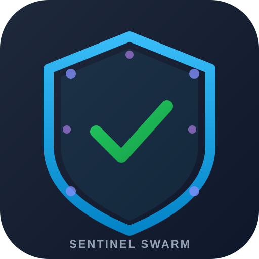
</p>

<div align="center">

# Sentinel Swarm — Smart Attendance Management System

A full-stack, multi-modal **attendance management system** combining IoT hardware (ESP32 + Raspberry Pi) with a PHP/JS web dashboard, built for the **University of Peradeniya** to replace manual roll-call. Exhibited at **Pera Nexus 2026**.

      

**Fingerprint · RFID · Face · Voice · QR · Manual**

[](https://meshannawod.github.io/smart-attendance-management-system_v_3/)

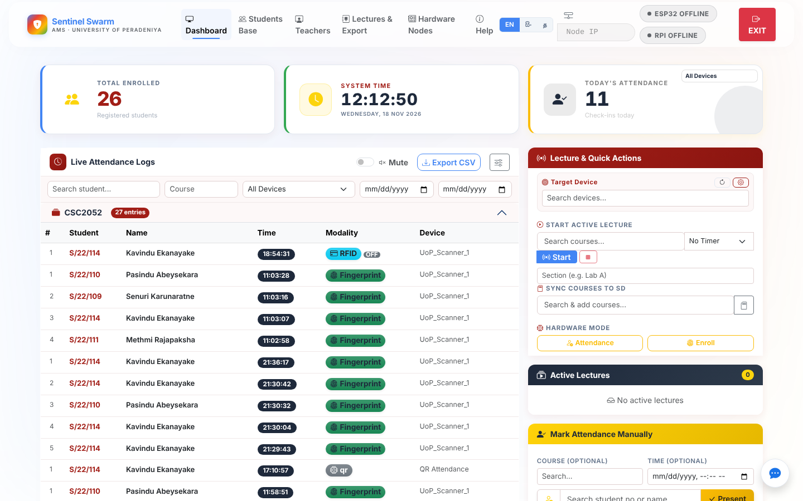

</div>

> **Versions:** this is **v3**, the complete system. Earlier stages: [v2](https://github.com/MeshanNawod/smart-attendance-management-system_v_2) (first PHP dashboard with face recognition) and [v1](https://github.com/MeshanNawod/smart-attendance-management-system_v_1) (deployment pipeline). Project website: **[meshannawod.github.io/smart-attendance-management-system_v_3](https://meshannawod.github.io/smart-attendance-management-system_v_3/)**.

---


## Screenshots

Take the full guided tour on the **[project website](https://meshannawod.github.io/smart-attendance-management-system_v_3/#tour)**.

| Analytics | Lecturer dashboard |
|---|---|
| 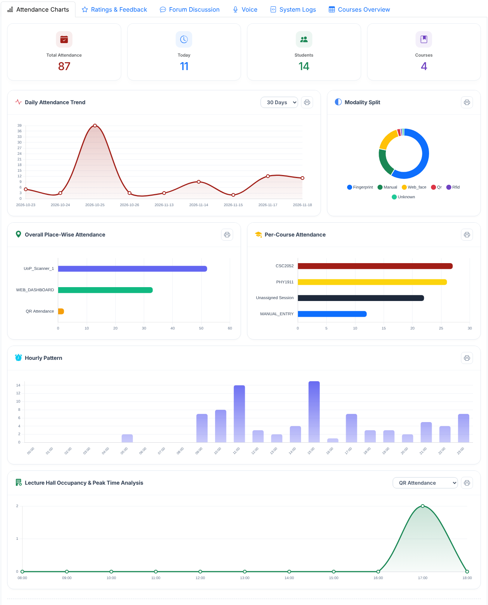 | 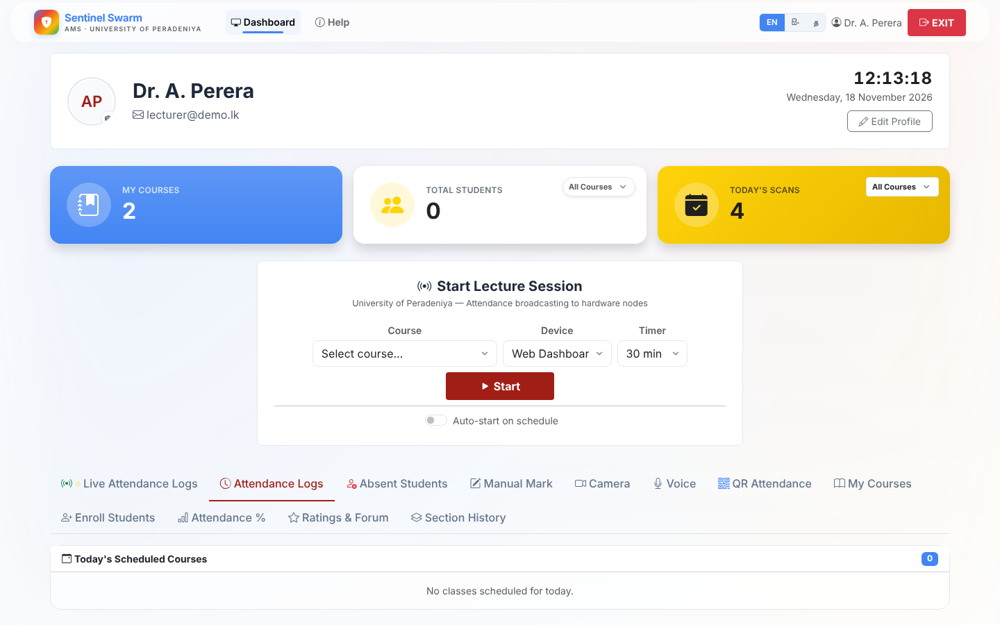 |
| **Student dashboard** | **Hardware nodes** |
| 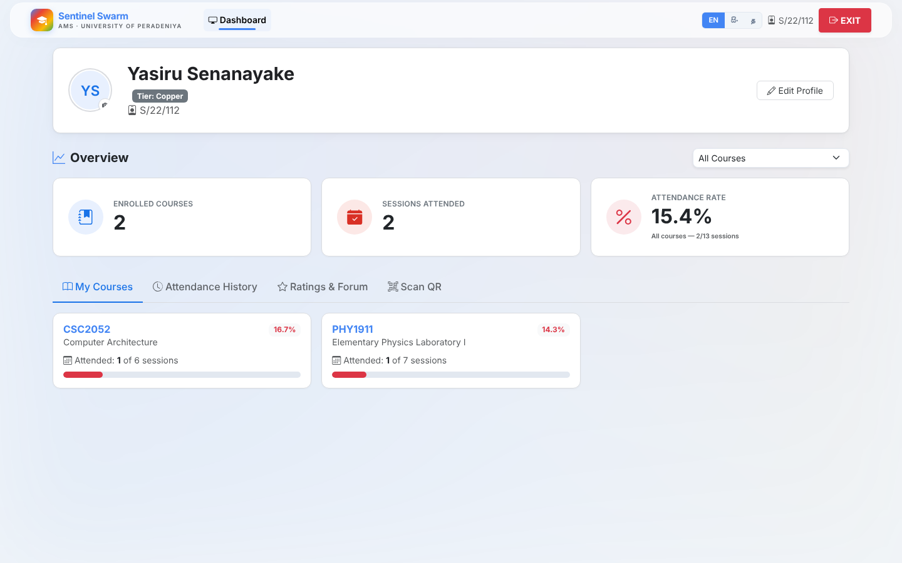 | 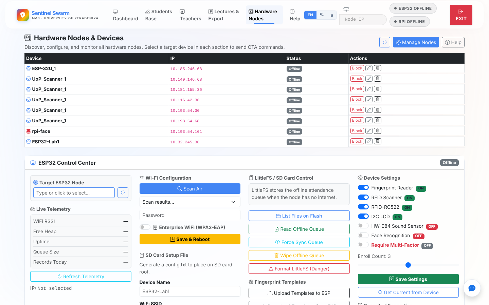 |
| **Students and courses** | **Reports and email alerts** |
| 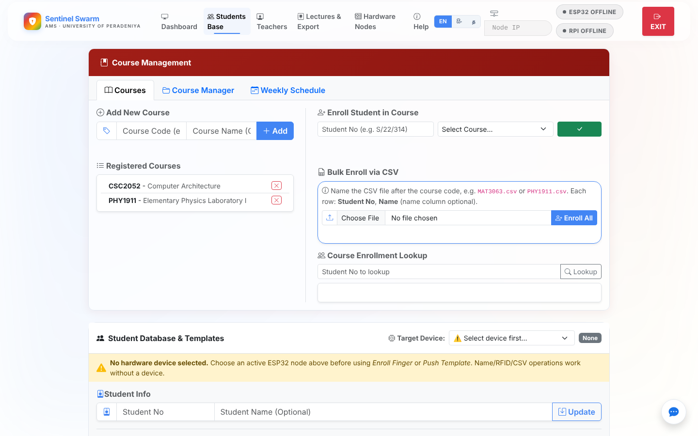 | 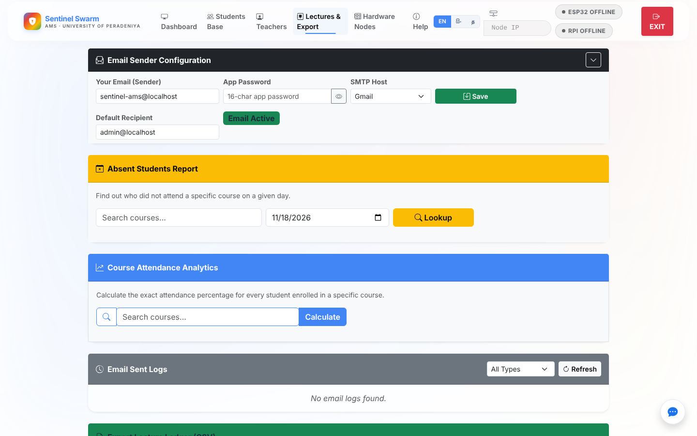 |

<sub>Screenshots use demo data; student and lecturer names are made up.</sub>

## QR attendance v2

🔳 **[Try to cheat it](https://meshannawod.github.io/smart-attendance-management-system_v_3/qr.html)**: an interactive model of the rotating QR rules, with each trick (photo sent to a friend, borrowed phone, skipped code, ended lecture) and the check that stops it.

- A new random code every **5 seconds**; a student must scan **two consecutive codes**
- Codes belong to the **running lecture** and stop working when it ends
- **One phone, one student, per lecture**; blocked attempts are **flagged** on the lecturer's screen
- Fixed: students on the same Wi-Fi were blocked after the first, a false "Database error" after check-in, scans completing with no attendance, and admins unable to use QR

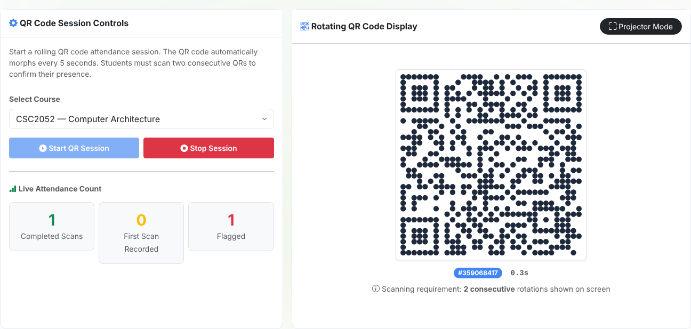

## Build the ESP32 node

⚡ **[Interactive wiring](https://meshannawod.github.io/smart-attendance-management-system_v_3/wiring.html)**: hover any wire to light up the whole connection, for the ESP32 node, the Raspberry Pi node and the whole system.

Full step-by-step guide: **[ESP32 build guide](https://meshannawod.github.io/smart-attendance-management-system_v_3/build.html)** (parts list, pin table, power, assembly with test sketches, flashing, `config.txt`, troubleshooting).

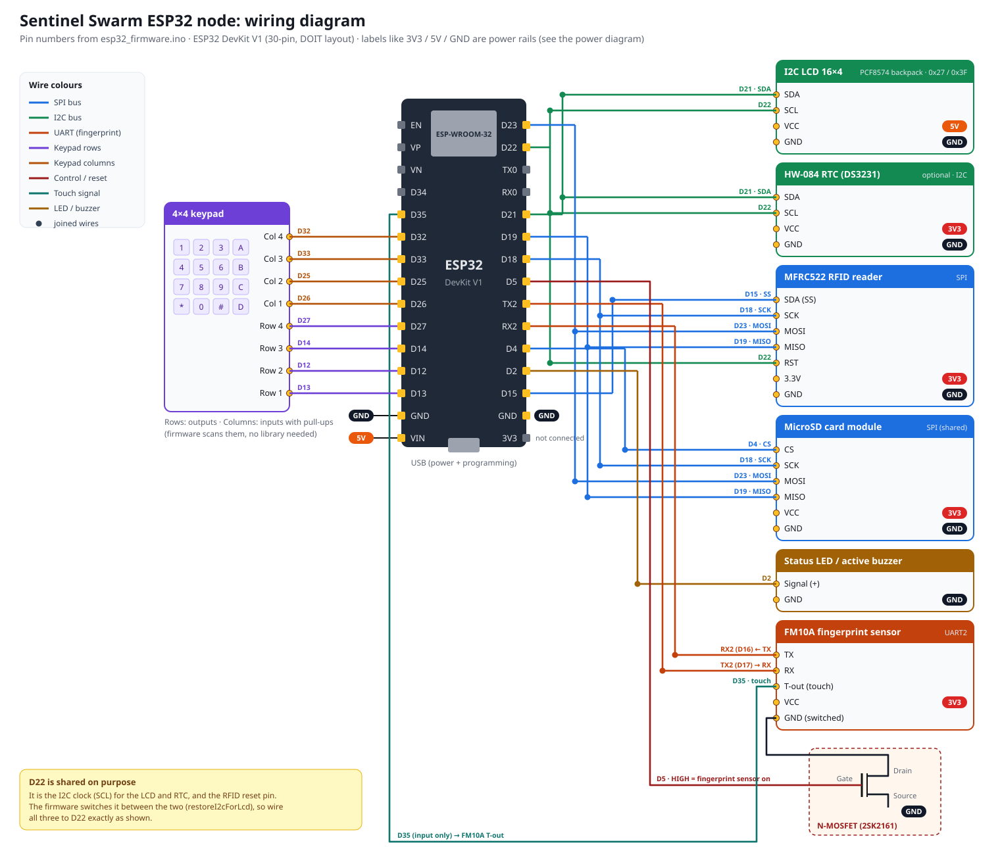

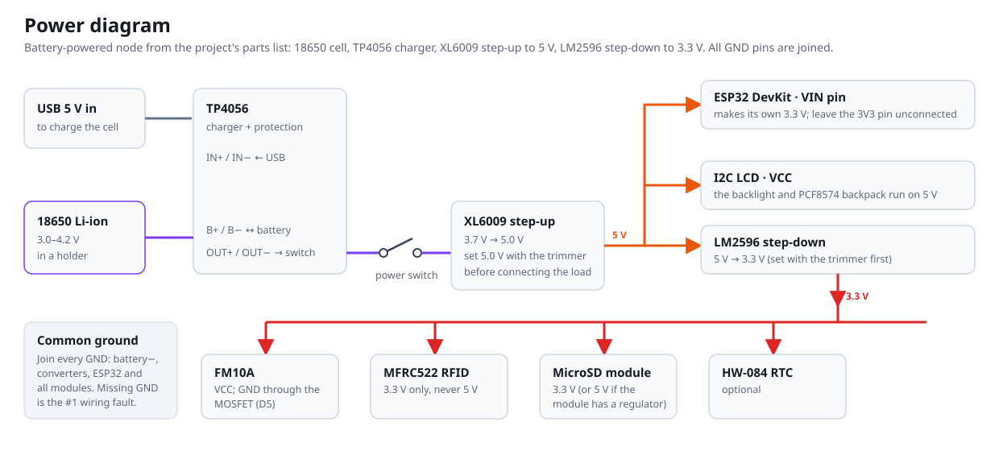

### At Pera Nexus 2026

| | |
|---|---|
| 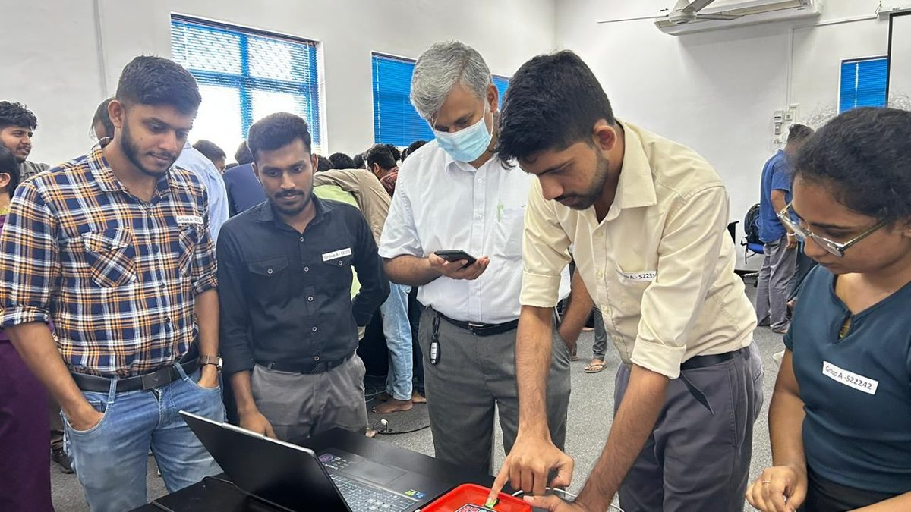 | 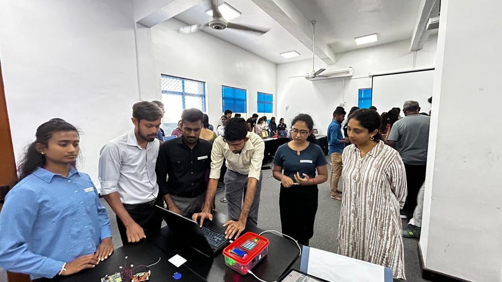 |

---

## Features

### Multi-Modal Attendance
| Method | Device | Description |
|--------|--------|-------------|
| Fingerprint | ESP32 + FM10A | Enroll once, share across all sensors campus-wide |
| RFID | ESP32 + MFRC522 | Tap student ID cards |
| Face Recognition | Web Browser | face-api.js in-browser with liveness detection |
| Face Recognition | Raspberry Pi | Pi Camera + OpenCV for entrance/exit tracking |
| Voice | Web Browser | Speaker verification via audio fingerprinting |
| QR Code | Web Browser | Dynamic QR refreshes every 5s (anti-spoof) |
| Manual | Dashboard | Lecturers can mark manually from any device |

### Hardware Nodes
- **ESP32-based** attendance terminals with 4x4 keypad, I2C LCD (16x4), FM10A fingerprint sensor, MFRC522 RFID reader, SD card for offline queue, and buzzer
- **Raspberry Pi 3B+** with Pi Camera for face recognition at entrances
- **Custom expansion board** with 18650 battery, TP4056 charger, XL6009 boost converter, MOSFET power gating
- OTA firmware updates pushed from the dashboard
- ESP-NOW mesh networking for offline device-to-device communication

### Dashboard (Admin)
- Real-time attendance logs with student name, No, timestamp, device, and modality
- Student database with bulk enrollment (CSV, photo upload)
- Teacher management, course scheduling, and timetable
- Device control center: serial monitor, LCD mirror, virtual keypad, Wi-Fi scanner, Bluetooth scanner
- Fingerprint template download/upload across FM10A sensors
- Live LCD mirror showing exactly what's on the physical display
- SD card configuration download for first-time device setup
- System logs, analytics charts, attendance summaries
- Offline queue management — data syncs when connection is restored
- Email notifications for absent students (<80% attendance)
- Multi-language support

### Dashboard (Teacher)
- My Courses with enrolled student lists
- Start/stop lecture sessions (triggers hardware nodes)
- Manual attendance marking (face, voice, QR)
- View attendance records, ratings, session history
- Forum discussion for each course

### Student Self-Service
- View personal attendance record and punctuality
- Link face/voice biometrics
- Update profile and photo

### Face Recognition Pipeline
- **Browser**: face-api.js (TensorFlow.js) — 128-d descriptors, liveness detection (blink, head turn)
- **Raspberry Pi**: OpenCV Haar Cascade + 4096-d vector encoding + cosine similarity
- Face data is shared across web and RPi pipelines for consistency
- Bulk enrollment from university ID photo database

### Power Management
- 18650 Li-ion battery + TP4056 charger
- XL6009 step-up (3.7V → 5V)
- LM2596 step-down (5V → 3.3V)
- 2SK2161 MOSFETs for component power gating
- Automatic sleep after inactivity

---

## Quick Install (Raspberry Pi)

### Prerequisites
- Raspberry Pi 3B+ or newer
- Pi Camera or USB webcam
- Raspberry Pi OS Bookworm (64-bit)

### One-Line Setup
```bash
# 1. Install Apache + PHP + MariaDB
sudo apt update && sudo apt install -y apache2 php libapache2-mod-php php-mysql php-curl php-mbstring php-xml mariadb-server

# 2. Clone the project
sudo mkdir -p /var/www/html/csc2052
# Copy project files to /var/www/html/csc2052

# 3. Import database
sudo mariadb -e "CREATE DATABASE IF NOT EXISTS csc2052 CHARACTER SET utf8mb4 COLLATE utf8mb4_general_ci;"
sudo mariadb csc2052 < /var/www/html/csc2052/csc2052.sql

# 4. Set permissions
sudo chown -R www-data:www-data /var/www/html/csc2052
sudo chmod -R 755 /var/www/html/csc2052

# 5. Enable HTTPS for camera access
sudo openssl req -x509 -nodes -days 365 -newkey rsa:2048 \
  -keyout /etc/ssl/private/selfsigned.key \
  -out /etc/ssl/certs/selfsigned.crt \
  -subj "/CN=$(hostname -I | awk '{print $1}')"
sudo a2enmod ssl
# Configure virtual host with SSLEngine on (see docs)

# 6. (Optional) Face Recognition Service
cd ~/rpi_flask
python3 -m venv venv --system-site-packages
source venv/bin/activate
pip install opencv-python flask flask-cors psutil
# Enable camera: sudo raspi-config nonint do_camera 0
# Start: sudo systemctl enable --now rpi-face.service
```

### Hardware Setup
1. Connect Pi Camera to CSI port (blue, between HDMI and audio)
2. Enable camera interface: `sudo raspi-config` → Interface Options → Camera
3. Set camera overlay: `echo "dtoverlay=ov5647" | sudo tee -a /boot/firmware/config.txt` (v1 camera) or `imx219` (v2)
4. Reboot: `sudo reboot`

---

## ESP32 Firmware

The ESP32 firmware (`esp32_firmware/esp32_firmware.ino`) supports:
- FM10A fingerprint sensor enrollment and matching
- MFRC522 RFID card reading
- 4x4 matrix keypad with multi-tap text input
- I2C LCD (16x4) display
- Web server for OTA commands and dashboard integration
- SD card for offline queue and template storage
- WiFi connectivity with hardware key authentication
- ESP-NOW mesh for offline communication
- Heartbeat sync every 30 seconds

### OTA Commands
| Command | Description |
|---------|-------------|
| GETSTATUS | Device status (WiFi, heap, uptime, queue) |
| GETCONFIG | Show current config |
| SETCONFIG ... | Set config values |
| ENROLL_FP | Enroll fingerprint |
| DELETE_FP_SLOT N | Delete slot N |
| DOWNLOAD_FP_TEMPLATES | Sync missing templates from server |
| LOAD_TEMPLATE N | Download & import template for slot N |
| SCANWIFI | List available WiFi networks |
| SCANBT | List Bluetooth devices |
| CONNECTWIFI SSID PASS | Connect to WiFi |

---

## API Endpoints

| Endpoint | Description |
|----------|-------------|
| `POST /api/student.php` | Student CRUD, attendance marking, face linking |
| `POST /api/teacher.php` | Teacher CRUD, course management |
| `GET /api/esp_courses.php` | Course/slot/template data for ESP32 |
| `GET /api/esp_ota_proxy.php` | Proxy OTA commands to ESP32 |
| `GET /api/heartbeat.php` | Device heartbeat + registration |
| `GET /api/sse_monitor.php` | Server-Sent Events for serial monitor |
| `POST /api/attendance/fingerprint/record.php` | Fingerprint attendance |
| `POST /api/attendance/rfid/record.php` | RFID attendance |
| `POST /api/attendance/voice/record.php` | Voice attendance |
| `POST /api/attendance/face/record.php` | Face attendance (RPi) |
| `POST /api/system_logs.php` | ESP32 log submission |
| `GET /api/ota.php` | OTA command queue polling |

All hardware endpoints require `hardware_key` or valid session token.

---

## Project Structure

```
csc2052/
├── api/                        # PHP backend API endpoints
│   ├── attendance/             # Modality-specific recorders
│   ├── student.php             # Student management & attendance
│   ├── teacher.php             # Teacher & course management
│   ├── esp_courses.php         # ESP32 course/template data
│   ├── esp_ota_proxy.php       # OTA command proxy
│   ├── heartbeat.php           # Device heartbeat
│   ├── sse_monitor.php         # Server-Sent Events
│   ├── system_logs.php         # Device log collection
│   ├── device_password.php     # Device PIN management
│   ├── voice_settings.php      # TTS configuration
│   ├── ratings.php             # Ratings & forum
│   └── ota.php                 # OTA command queue
├── assets/                     # Images, logos, favicon
├── css/                        # Stylesheets
├── includes/                   # PHP helpers, auth, database, cards
│   ├── auth/                   # Session & authentication
│   ├── cards/                  # Dashboard card components
│   ├── config/                 # App configuration
│   ├── dashboard/              # Dashboard-specific includes
│   ├── database/               # DB connection
│   └── helpers/                # Shared utility functions
├── js/                         # JavaScript
│   ├── vendor/                 # Third-party libs
│   ├── face_recognition.js     # Browser-based face API
│   └── main.js                 # Core dashboard logic
├── weights/                    # face-api.js model weights
├── models/                     # face-api.js model weights (mirror)
├── rpi_flask/                  # Raspberry Pi Flask service
│   ├── app.py                  # Face recognition service
│   ├── config.json             # Flask service config
│   ├── requirements.txt        # Python dependencies
│   └── setup.sh                # Automated Pi setup
├── esp32_firmware/             # ESP32 Arduino firmware
│   └── esp32_firmware.ino      # Main firmware (4461 lines)
├── sql/                        # Database migrations
├── csc2052.sql                 # Full database dump
├── index.php                   # Main entry point
├── device.php                  # Device control center
└── README.md                   # This file
```

---

## Security

- All API endpoints require authentication (session token or hardware key)
- CSRF protection on mutating operations
- Hardware API key validated on every device request
- No database error messages leaked to clients (all logged server-side)
- SSRF protection on OTA proxy and SSE monitor (IP validation + private range rejection)
- XSS prevention via `json_encode()` for dynamic script content
- Device registry names sanitized to `[a-zA-Z0-9_\- ]`
- Session fingerprint includes IP + User-Agent
- Permissions-Policy: microphone restricted to self-origin

---

## Technologies

| Component | Technology |
|-----------|------------|
| Backend | PHP 8.2, Apache 2.4, MariaDB 10.4 |
| Frontend | Vanilla JS, Bootstrap 5, face-api.js |
| Firmware | Arduino/C++ (ESP32 Arduino Core) |
| Face (RPi) | Python 3, OpenCV, Flask, picamera2 |
| Face (Browser) | TensorFlow.js (face-api.js) |
| Icons | Bootstrap Icons |
| Charts | (custom JS) |

---

## License

Academic project — University of Peradeniya
